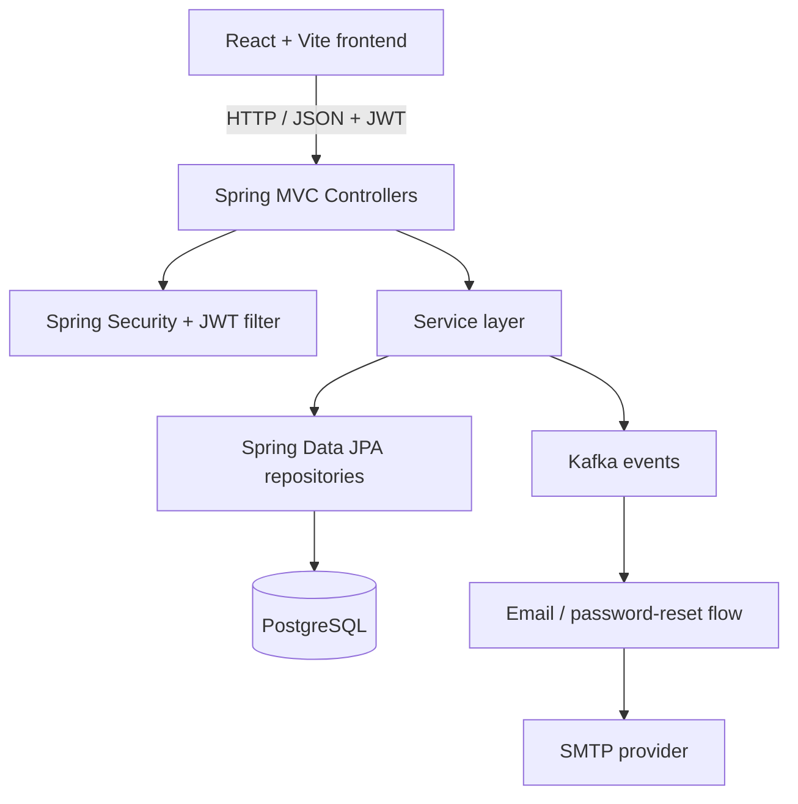
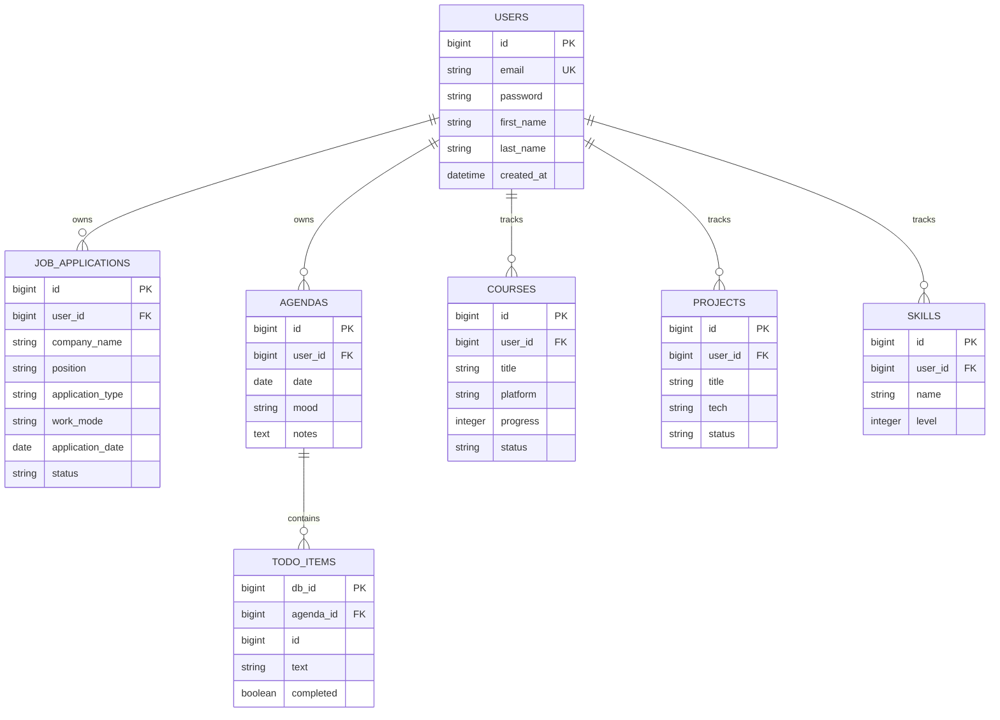

# Job Tracker — Backend

A Spring Boot REST API for **Pebble / Job Tracker**, a personal workspace for tracking job applications, planning daily tasks, and organizing professional development.

> **Project status:** Portfolio / learning project. The current code has security and integration limitations listed below; do not deploy it with real user data before addressing them.

## Related repository

- **Frontend:** [jobtracker-frontend](https://github.com/seydagultopal/jobtracker-frontend)
- **Backend (this repository):** [jobtracker-backend](https://github.com/seydagultopal/jobtracker-backend)

## Features

- Account registration, login, JWT-based authentication, and password-reset flow.
- Job application CRUD with company, position, application type, work mode, status, date, salary, platform, notes, and other details.
- Daily agenda with notes, mood, and to-do items.
- Professional development tracking for courses, projects, and skills.
- User profile and CV-related information.
- PostgreSQL persistence through Spring Data JPA / Hibernate.
- Kafka-based password-reset event flow and SMTP email support.

## Technology stack

- Java 17
- Spring Boot 4.0.3
- Spring Web MVC, Spring Security, Spring Validation
- Spring Data JPA / Hibernate
- PostgreSQL
- JWT (JJWT)
- Apache Kafka and Spring Kafka
- Spring Mail
- Maven, JUnit 5 / Spring Boot test dependencies
- Docker (Dockerfile is provided)

## Architecture

The application uses a layered, feature-oriented structure. Controllers expose HTTP endpoints, services contain application logic, repositories access PostgreSQL through JPA, and DTOs define selected API payloads.



Main package areas:

| Package | Responsibility |
|---|---|
| `auth` | Registration, login, JWT, password-reset flow, email |
| `application` | Job application entities, DTOs, CRUD endpoints |
| `agenda` | Daily agenda and to-do items |
| `development` | Courses, projects, skills |
| `user` | User profile and account settings |
| `config` | Security, application beans, Kafka configuration |

## API overview

The API currently has no generated OpenAPI/Swagger specification. The table below reflects the controller mappings in the source code.

| Method | Endpoint | Purpose | Authentication |
|---|---|---|---|
| POST | `/api/auth/register` | Register an account | No |
| POST | `/api/auth/login` | Log in and receive a JWT | No |
| POST | `/api/auth/forgot-password` | Request a password-reset email | No |
| POST | `/api/auth/reset-password` | Set a new password using a reset token | No |
| GET | `/applications` | List the current user's applications | JWT |
| POST | `/applications` | Create an application | JWT |
| PUT | `/applications/{id}` | Update an application | JWT |
| DELETE | `/applications/{id}` | Delete an application | JWT |
| GET | `/agenda/{date}` | Read agenda for a date (`YYYY-MM-DD`) | JWT |
| POST | `/agenda/{date}` | Create/update agenda for a date | JWT |
| GET / POST | `/api/development/courses` | List/add courses | JWT |
| PUT / DELETE | `/api/development/courses/{id}` | Update/delete a course | JWT |
| GET / POST | `/api/development/projects` | List/add projects | JWT |
| PUT / DELETE | `/api/development/projects/{id}` | Update/delete a project | JWT |
| GET / POST | `/api/development/skills` | List/add skills | JWT |
| PUT / DELETE | `/api/development/skills/{id}` | Update/delete a skill | JWT |
| GET / PUT | `/api/users/me` | Read/update current profile | JWT |
| PUT | `/api/users/me/email` | Change account email | JWT |
| PUT | `/api/users/me/password` | Change account password | JWT |

### Example: register

```http
POST /api/auth/register
Content-Type: application/json
```

```json
{
  "firstName": "Ada",
  "lastName": "Yilmaz",
  "email": "ada@example.com",
  "password": "ExamplePassword!9"
}
```

Example success response:

```json
{
  "message": "Kayıt işlemi başarıyla tamamlandı!"
}
```

### Example: login

```http
POST /api/auth/login
Content-Type: application/json
```

```json
{
  "email": "ada@example.com",
  "password": "ExamplePassword!9"
}
```

Response shape:

```json
{
  "token": "<JWT>"
}
```

Use the token on protected endpoints:

```http
Authorization: Bearer <JWT>
```

### Example: create a job application

```http
POST /applications
Authorization: Bearer <JWT>
Content-Type: application/json
```

```json
{
  "companyName": "Example Technology",
  "position": "Backend Developer",
  "applicationType": "JOB",
  "workMode": "HYBRID",
  "location": "Istanbul",
  "applicationDate": "2026-10-15",
  "status": "APPLIED",
  "salary": "Negotiable",
  "description": "Java and Spring Boot role",
  "applicationQuestions": "",
  "platform": "Company careers page",
  "notes": "Follow up next week"
}
```

The response is a `JobApplicationResponse` with an `id` and the application fields. The delete endpoint returns `204 No Content` on success.

Supported enum values:

- `applicationType`: `JOB`, `INTERNSHIP`, `BOOTCAMP`, `WEBINAR`, `OTHER`
- `workMode`: `REMOTE`, `HYBRID`, `ONSITE`
- `status`: `APPLIED`, `ASSESSMENT`, `VIDEO_INTERVIEW`, `INTERVIEW`, `OFFER`, `REJECTED`

## Data model

Hibernate currently manages the schema with `spring.jpa.hibernate.ddl-auto=update`. The main entities and relationships are:



The `users` table also stores profile and CV fields such as contact details, bio, profile/cover photo data, experiences, and education. Password-reset tokens are represented separately.

## Security and user-data isolation

- Protected endpoints use Spring Security and JWT authentication.
- User-owned entities include a `user_id` relationship; job application operations receive the authenticated principal and service methods perform ownership checks.
- The API uses request/response DTOs for job applications and development resources.

**Important hardening work is still required before real-world use:**

1. A mail credential was committed in the application configuration. Revoke/rotate it immediately; removing it from the latest file does not remove it from Git history.
2. The JWT signing key is hard-coded in `JwtService`. Move it to a secret/environment-based configuration and rotate it.
3. Registration currently assigns the submitted password directly instead of using the configured `PasswordEncoder`. Fix this before allowing registrations; passwords must be stored as adaptive hashes.
4. The profile controller returns the `User` entity directly, including its password property. Return a dedicated response DTO that never serializes credentials.
5. The frontend currently calls `/auth/register`, while the backend mapping is `/api/auth/register`. Align the paths before testing the registration flow.
6. JWTs are stored in browser `localStorage`; assess the XSS threat model and choose token storage/mitigations deliberately.

Do not use real credentials or personal data with the current version.

## Run locally

### Prerequisites

- JDK 17
- Docker with Docker Compose (for PostgreSQL and Kafka)
- Node.js and npm for the frontend
- An SMTP account only if you want to test email-based password reset

### 1. Start PostgreSQL and Kafka

Create a `docker-compose.yml` file in the backend repository using the following local-development services:

```yaml
services:
  postgres:
    image: postgres:16
    container_name: jobtracker-postgres
    environment:
      POSTGRES_DB: jobtracker_db
      POSTGRES_USER: postgres
      POSTGRES_PASSWORD: postgres
    ports:
      - "5432:5432"
    volumes:
      - jobtracker-postgres-data:/var/lib/postgresql/data

  kafka:
    image: bitnami/kafka:3.7
    container_name: jobtracker-kafka
    ports:
      - "9092:9092"
    environment:
      KAFKA_CFG_NODE_ID: 0
      KAFKA_CFG_PROCESS_ROLES: controller,broker
      KAFKA_CFG_CONTROLLER_QUORUM_VOTERS: 0@kafka:9093
      KAFKA_CFG_LISTENERS: PLAINTEXT://:9092,CONTROLLER://:9093
      KAFKA_CFG_ADVERTISED_LISTENERS: PLAINTEXT://localhost:9092
      KAFKA_CFG_LISTENER_SECURITY_PROTOCOL_MAP: CONTROLLER:PLAINTEXT,PLAINTEXT:PLAINTEXT
      KAFKA_CFG_CONTROLLER_LISTENER_NAMES: CONTROLLER
      ALLOW_PLAINTEXT_LISTENER: "yes"

volumes:
  jobtracker-postgres-data:
```

Start the services:

```bash
docker compose up -d
```

The current local defaults in `application.properties` use PostgreSQL at `localhost:5432` and Kafka at `localhost:9092`. Override database and mail settings with environment variables for your own environment; never commit real credentials.

### 2. Run the backend

From the backend repository root:

```bash
./mvnw spring-boot:run
```

On Windows PowerShell:

```powershell
.\mvnw.cmd spring-boot:run
```

The API listens on `http://localhost:8080` by default.

### 3. Run the frontend

Follow the [frontend README](https://github.com/seydagultopal/jobtracker-frontend#run-locally). The frontend's API service currently targets `http://localhost:8080`.

### Run the backend in Docker

The existing Dockerfile expects the JAR to be built first:

```bash
./mvnw clean package -DskipTests
docker build -t jobtracker-backend .
```

If PostgreSQL and Kafka run on the host, pass host-reachable URLs and credentials to the container. On Docker Desktop, `host.docker.internal` is usually available; on Linux, add `--add-host=host.docker.internal:host-gateway`.

```bash
docker run --rm -p 8080:8080 \
  --add-host=host.docker.internal:host-gateway \
  -e SPRING_DATASOURCE_URL=jdbc:postgresql://host.docker.internal:5432/jobtracker_db \
  -e SPRING_DATASOURCE_USERNAME=postgres \
  -e SPRING_DATASOURCE_PASSWORD=postgres \
  -e SPRING_KAFKA_BOOTSTRAP_SERVERS=host.docker.internal:9092 \
  -e SPRING_MAIL_USERNAME=your-smtp-account@example.com \
  -e SPRING_MAIL_PASSWORD=your-smtp-app-password \
  jobtracker-backend
```

These are development examples, not production secrets. The JWT signing key is still hard-coded in the current implementation and must be externalized before deployment.

## Tests

Run the existing backend test suite:

```bash
./mvnw test
```

The current test suite contains a Spring application-context smoke test. Service, controller, authentication, and cross-user authorization tests are still needed; test coverage should not be interpreted as comprehensive.

## Known limitations

- No production deployment configuration or complete Docker Compose setup is committed yet.
- Database schema uses Hibernate `update`; a migration tool such as Flyway is not configured.
- Automated tests currently cover only application-context startup.
- Registration password hashing, response DTOs for user profiles, and secret management need to be fixed.
- The frontend registration URL does not currently match the backend route.
- Error responses and HTTP status mapping should be standardized, and API validation/authorization tests should be expanded.

## License

No license file is currently included. Unless a license is added, reuse and redistribution are not explicitly granted.
